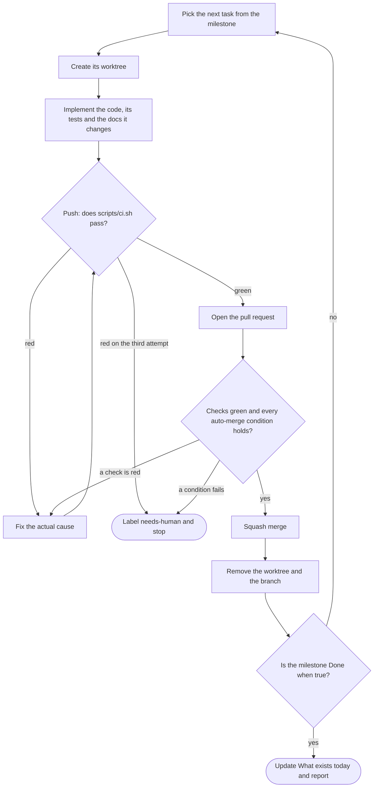

# project-docs

Turns a project description into a complete plan: `PROJECT.md`, `CLAUDE.md`, `README.md` and a
numbered `docs/` set, on a fixed baseline for the project's platform: a TypeScript monorepo for
web services and apps, a native Swift app for macOS, or a TypeScript command-line tool. Every
diagram it draws is Mermaid, inside the plan's own Markdown.

Derived from existing projects whose documentation shares one shape and, per platform, one
toolchain, so the next project inherits the reasoning rather than re-deriving it.

```
PROJECT.md          problem · proposal · principles · scope · document map · D-xx register
CLAUDE.md           non-negotiables · boundaries · commands · conventions · the delivery loop
README.md           running the code, and nothing else
docs/
  01-product.md              personas · FR-xx / NFR-xx inventory · metrics · non-goals
  02-<domain core>.md        the one thing this does, specified to the level of a test
  03-architecture.md         components · boundaries · request path · jobs · deployment
  04-data.md                 every table · retention · what is not stored · security · privacy
  …                          admin · integrations · auth · design · billing · migration, as earned
  NN-engineering-practices.md
  NN-roadmap.md              milestones with "Done when" · risks · definition of done
  NN-stack.md                every dependency: why, and what replacing it costs
  NN-provider-setup.md       field-by-field provider setup · every env var
```

**Four properties.** If the output does not have all four, the skill did not do its job:

1. **Every decision carries its reasoning and its reversal condition.** A `D-xx` register where a
   closed decision keeps its ID and gains the argument, including the option that was rejected and
   why.
2. **Requirements are inventoried and identified.** `FR-xx` / `NFR-xx` with priorities, referenced
   by the roadmap, so "done" is checkable rather than felt.
3. **The stack is fixed, not chosen fresh.** Only the genuinely project-dependent slots get
   decided, and each one is decided in the register with its alternative named.
4. **Absences are recorded.** "What was deliberately not used", with reasons.

**The stack it plans on**, per profile, picked at intake.

*web.* Fixed: TypeScript strict · Node ≥ 22 · pnpm + Turborepo · Biome (no
ESLint, no Prettier) · Zod at every boundary · PostgreSQL + Drizzle · Pino ·
Vitest / Testcontainers / Playwright · Next.js + Tailwind where there is a UI.

For HTTP what is fixed is the property rather than the framework: a route is declared once, and
that declaration is the validation, the OpenAPI document, and the type the client is generated
from. Decided per project, each with its alternative named and priced: the HTTP framework (Elysia
or Hono), the runtime (Node or Bun), background work (transactional outbox or BullMQ), Postgres
hosting, identity, object storage, mail, where the check suite runs, deployment, and tenancy.

*macos.* Fixed: Swift 6 with complete strict concurrency · SwiftUI, with AppKit for the status item
and popover · XcodeGen (the `.xcodeproj` is generated, never committed) · one `<Name>Kit` Swift
package with a target per concern, the boundaries enforced by SwiftPM · swift-format and SwiftLint
· Swift Testing · lefthook · gitleaks · release-please · `os.Logger` · a `--snapshot` mode so an
agent can check a view. Decided per project: the deployment target, persistence (JSON files split
by writer, or GRDB), signing (self-signed, Developer ID, App Store), updates (an updater of its own
over GitHub Releases, Sparkle, App Store), credentials, the sandbox, and where the check suite
runs (hosted macOS minutes cost ten times as much on a private repository).

*cli.* Fixed: the web toolchain without the server (TypeScript strict, Node ≥ 22, pnpm, Biome,
Zod, Vitest) · commander · @clack/prompts only on a TTY · tsdown bundling everything into one file
· a pure `src/core` and `main(argv, io)` so every command runs in-process in a test · a written
command-line contract (stdout is data, `--json`, documented exit codes, no prompt without a TTY)
· XDG paths · unit, in-process integration, and golden end-to-end tests against the packed and
installed package · npm trusted publishing. Decided per project: distribution (npm, or binaries
with a Homebrew tap), platforms, credentials, layout, per-directory config, update notice, and
where the check suite runs.

**The repository, for every profile.** A `scripts/configure-repo.sh` the user runs once in `M0`:
squash merge only, auto-merge allowed, branches deleted on merge, Dependabot security updates,
labels the loop uses, and a ruleset on `main` (no deletion or force push, linear history, a pull
request, conversations resolved, every hosted check required, no bypass). A hosted workflow with
one job per test layer, unit, integration and end to end, matching the local gate job for job.

When the user names a project of theirs as the model, it reads that project first and its choices
win over the baseline, each recorded as a decision.

**The delivery loop.** The generated `CLAUDE.md` and engineering-practices document both carry one
loop, so a human and an agent run the same one:



| Step | Command |
|---|---|
| worktree | `wt switch --create <type>/<milestone>-<slug>` |
| gate | `git push`, whose pre-push hook runs `./scripts/ci.sh` |
| open | `gh pr create --base main --fill --label goal:<milestone>` |
| wait and merge | `gh pr merge --squash --auto` when the checks are hosted; `gh pr merge --squash` when they run locally only |
| clean up | `git fetch --prune origin && wt remove` (the merge already deleted the remote branch) |

Every task runs in its own [worktrunk](https://worktrunk.dev) worktree, made ready on creation by
`.config/wt.toml` (on web: install, env files, its own ports and database; on macos: install and
the generated Xcode project), so parallel tasks never share a working tree.

The gate runs before the pull request exists, so a red branch never becomes somebody's review.
Three failed attempts on the same check means `needs-human` and stop. Deleting a test, loosening a
lint rule, widening a type or `--no-verify` are never a fix. The repository is named once, in
`CLAUDE.md`, and is never inferred.

Ask for a scaffold and it also emits the toolchain the documents promise. Ask it to build, and it
runs the loop until the milestone is done.

**Calibration.** [`references/calibration.md`](references/calibration.md) holds illustrative passages
written in the target voice, about fictional products. That is what keeps the generated prose from
reading like generated prose.
