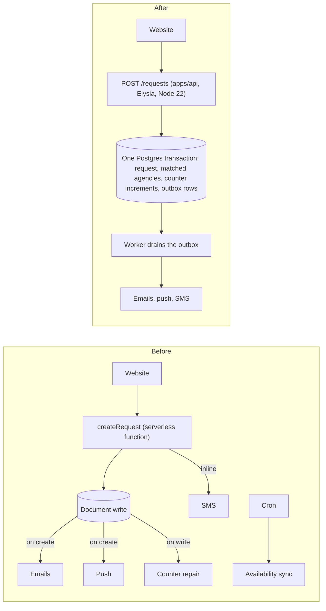

# Calibration

Illustrative passages written in the voice of the reference set. Read these when the prose is
coming out generic. Rules describe the voice; these demonstrate it.

Every product, name and number below is fictional. Three imaginary projects carry the examples:

- **A marketplace rewrite**: a tutoring marketplace that routes each student request to a tutor
  agency, and bills agencies per request received.
- **A multi-tenant SaaS bot**: a chat bot that tracks pull requests and nudges reviewers.
- **Beacon** (macos profile): a menu bar app that watches the status pages of the services a team
  depends on and notifies when one degrades.

---

## A problem statement that is checkable

> **The document store cannot express the query the product is built on.** The core operation is:
> *find the active agencies whose coverage includes this subject and neighbourhood, prefer the ones
> that list the neighbourhood over the ones that only list the city, and among those take the one
> that has received the fewest requests.* In Postgres that is one statement. In the document store
> it is a full collection read of every agency into memory, followed by filtering and sorting in
> JavaScript, on every single request. That works at hundreds of agencies. It does not work at
> thousands, and it already costs a read per agency per request.

The failure is named, the mechanism is shown, the cost is quantified, and the fix is implied
without being argued yet. Four sentences of context and two of consequence.

## A problem statement for a product that has no predecessor

> The official GitHub + Slack integration solves the wrong problem: it **broadcasts events** when
> the team needs **state** and **follow-up**.

Then five numbered pains in a table, each with its symptom, then:

> Systemic consequence: the channel becomes noise, the team learns to ignore it, time to first
> review goes up, and review becomes invisible work concentrated on two or three people.

There is always a predecessor. It may be a competitor, a spreadsheet, or a habit.

## Design principles that settle arguments

> 2. **The database enforces what the database can enforce.** Foreign keys, `NOT NULL`, `CHECK`,
>    unique constraints, exclusion constraints. Application-level invariants are the fallback, not
>    the plan.
> 3. **Money-adjacent state is transactional.** An agency's `requests_received` and a plan's
>    `credits_used` are what the business bills on. They move in the same transaction as the
>    request that moved them, or they do not move.

> 3. **The channel is expensive, the thread is cheap, the DM is precise.** Each destination has a
>    different attention cost. Noise goes to the thread; follow-up goes to the DM of whoever can
>    act.
> 4. **Nudging is a finite resource.** A reminder ignored three times becomes a reminder ignored
>    forever. Escalation must be rare enough to still mean something.

Each one decides a real review comment. None of them is a value.

## A closed decision

> **Closed — keep, but transactional.** `agencies.requests_received` is what the matching query
> orders by; computing it as `COUNT(*)` on every request would put an aggregate over the whole
> `requests` table on the hot path. It is incremented in the same transaction that inserts the
> request. `active_tutors` and `paused_tutors`, which nothing sorts by, become a view — the two
> trigger functions and the repair job that exist today disappear with them. A
> `POST /admin/recount` route is kept for operational comfort and to prove the invariant in tests.

Answer, the reason the obvious alternative loses (an aggregate on the hot path), the mechanism, and
the part of the *current* system that disappears as a result. Sixty words.

## Arguing an alternative that would also have worked

> Postgres is the source of truth and Redis is the queue, and the temptation to collapse them is
> worth resisting in writing. A queue in Postgres is a well-known pattern and it would work; what
> it costs is BullMQ's delayed jobs and job-id collapsing, both of which the product's central
> claim rests on. A source of truth in Redis is not a candidate at all — the data outlives any
> cache and half of it is relational.

The rejected option is conceded to be viable, and then priced. That is more convincing than
declaring it wrong, and it is what makes the decision survive being questioned later.

## A decision that reverses an earlier one

> **Reopened and closed again:** an account is an email address, optionally with a password, and
> Sign in with Slack or with GitHub opens the same account rather than a second kind of one […].
> "Zero new identities" was the right answer while a workspace was the only tenant, and it made a
> first-time visitor unreachable: with nothing installed there is no roster to be on, so the only
> door refused everybody who had not already arrived. […] **The mechanism was replaced once more:**
> all of it — sessions, the password, the reset, the verification, both OAuth round trips — is
> Better Auth now, over our own `users` table, because each of those written by hand was a small
> amount of code with a large number of ways to be quietly wrong.

Reversals are recorded, not tidied away — including the reason the *earlier* answer was right at
the time, which is what stops the same reversal happening twice.

## Bad news, in the same voice as everything else

> **What is lost is real**: the checks are enforced by the author's own machine, so
> `git push --no-verify` is a way past them and a green PR proves only that whoever pushed it did
> not use that flag. Nothing else in this repository is held by discipline alone. **Revisit when** a
> second person commits, or when the repository goes public.

> One known drift, recorded here rather than quietly carried: **Compose pins `postgres:16-alpine`
> and the integration suites pin `postgres:17-alpine`**, so every test runs against a major the
> production database is not. Nothing here uses a version-specific feature, which is why it has
> gone unnoticed — but the point of testing on a real container is that it is the *same* real
> container, and one of the two numbers should move.

## A dependency row that argues

> **BullMQ** | 5.81.3 | Redis-backed queues with delayed jobs and job ids. Both are load-bearing:
> the 8-second debounce is a delayed job, and "one message per pull request" survives a webhook
> storm because the job id collapses duplicates before a worker ever sees them | High

The two features are named, and each is tied to a product claim that would break without it.

## A milestone

> ## M2 — The domain
>
> `packages/domain`: matching, eligibility, masking, availability, address parsing, template
> helpers. Pure, no I/O, 100 % branch coverage. The eight worked examples and the four properties from
> `10-testing.md` §3 and §4.
>
> **Done when** the matching examples all pass and the masking property survives generated input.
> This is the milestone that decides whether the rest is correct; it is worth being slow here.

Contents, then a checkable "Done when", then one sentence of judgement about the milestone itself.

## A risk row whose mitigation is a mechanism

> | **Matching parity is wrong in a way tests miss** | requests routed to the wrong agencies,
> discovered as complaints | the replay in `08-migration.md` §6 over a sample of past requests; the pure
> function and the SQL asserted against each other; two approvals on any matching change |

Nothing in the third column is "be careful". All three are things already in the plan.

## A definition of done that is a sentence worth reading

> - A question about the business — which cities, which agencies, which month — is a SQL query, which
>   is the sentence this whole project exists to make true.

## A `README` state paragraph

> **The pipeline is built end to end.** Intake, matching, the outbox, and delivery over all four
> channels — everything the serverless implementation this replaces does. What is not built yet is
> the admin dashboard, identity, and the one-shot data migration. [`CLAUDE.md`](CLAUDE.md) has the
> table of what exists, and [`docs/11-roadmap.md`](docs/11-roadmap.md) the order the rest arrives
> in.

Claims what is true, names what is not, points at the authority for both. Three sentences.

## A before/after that carries a whole document



Every trigger on the left becomes either a row in the same transaction or an outbox entry on the
right, and the diagram says so without a paragraph.

And the same idea applied to a product surface rather than an architecture — the state of one
message at four points in time, which is the whole product argument in twelve lines. This one stays
plain text, because it is a mockup of what a person reads, not a graph:

```
  t+0     🟡 #4743 ci: make renovate ignore @northwind/ui packages    S · +12/−3
          checkout-ui · @ana · waiting on @bruno · 4m ago

  t+12m   🔴 #4743 ci: make renovate ignore @northwind/ui packages    S · +12/−3
          checkout-ui · @ana · build failed on `lint` · waiting on @bruno
          └ thread: 🔴 build failed on `lint` · [view log]      (+ DM to @ana)

  t+1h23  🏁 ~#4743 ci: make renovate ignore @northwind/ui packages~
          merged by @ana · open for 1h23 · reviewed by @bruno in 22m
```

Note the fixed fictional cast, declared once and reused across every document:

> Every name below is fictional. Cast used across all documents: org `northwind`, repos
> `checkout-ui` / `billing-api` / `design-system`, people `@ana`, `@bruno`, `@carla`, `@diego`,
> `@lia`.

Do this. Examples that share a cast read as one system; examples with fresh names each time read as
disconnected snippets.
