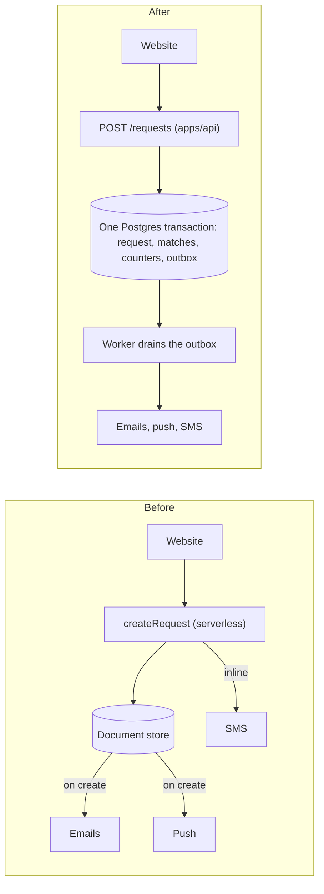
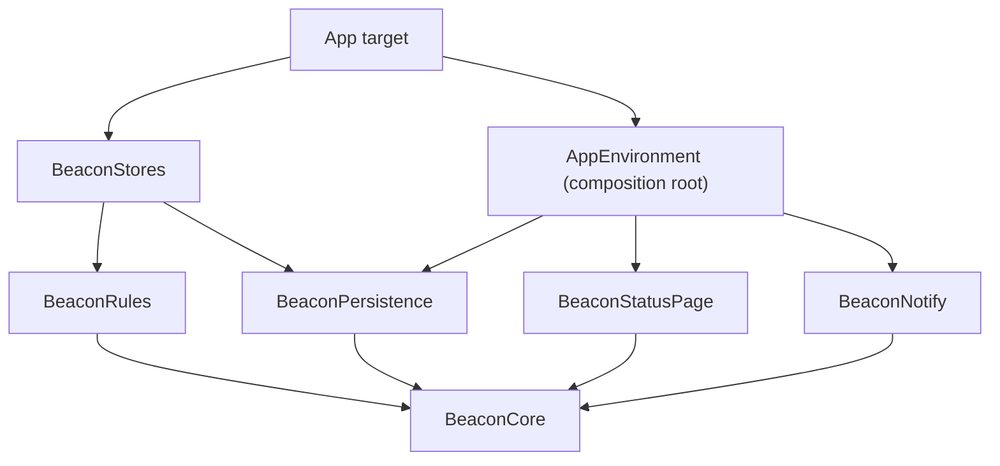
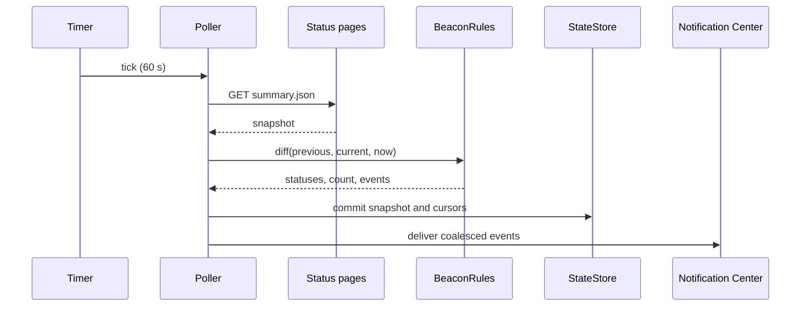

# Diagrams

Every diagram in the set is a fenced ` ```mermaid ` block. GitHub, GitLab and most editors render
it, it diffs as text, and a reviewer can change one edge without redrawing a box. ASCII art does
none of that: it breaks when one label grows by a character, and nobody edits it, so it rots first.

Two things stay as plain fenced text, because they are not graphs:

- **Directory trees** (`03-architecture.md` §2, the README layout). A tree with one comment per line
  is already the clearest form.
- **Mockups of rendered output** — a chat message over time, a menu bar popover, a notification, a
  terminal transcript. They show what a person sees, character by character, and Mermaid cannot.

Everything else that has nodes and edges is Mermaid.

## Which diagram for which shape

| Shape | Diagram | Where it usually appears |
|---|---|---|
| Before and after, components and what talks to what | `flowchart LR` with one `subgraph` per side | `PROJECT.md` §2, `03-architecture.md` §1 |
| Who may import whom | `flowchart TD`, an edge per allowed dependency | `03-architecture.md` §3, `CLAUDE.md` architecture |
| A process with decisions and loops | `flowchart TD` with `{decision}` nodes | The delivery loop, `02` flow end to end |
| A request, a poll or a job across several parties, in order | `sequenceDiagram` | `03-architecture.md` request path or poll path, `NN-integrations.md` |
| Something with states and transitions | `stateDiagram-v2` | A request's lifecycle, a subscription, a pull request's status in `02` |
| Entities and their relations | `erDiagram` | `04-data.md`, as a map above the tables |
| Milestones and what depends on what | `flowchart LR` | `NN-roadmap.md` |

The diagram is the map, never the specification. **The table or the prose next to it stays
authoritative**: `04-data.md`'s tables carry every column and constraint, and an `erDiagram` above
them shows only the relations. When the two disagree, the diagram is the bug.

## Rules

1. **One screen.** About 15 nodes. Past that, split it, or the diagram is a second copy of the
   prose that nobody can hold in their head.
2. **Quote every label** that contains anything beyond letters, digits and spaces:
   `gate{"Does scripts/ci.sh pass?"}`, `api["apps/api (Elysia)"]`. Parentheses, slashes, colons,
   dots and `#` inside an unquoted label are the usual cause of a diagram that does not render.
3. **Short, stable node ids**, labels for what is shown: `db[(Postgres)]`. Never use `end` as an id;
   it closes a subgraph.
4. **No angle brackets in labels.** `<branch>` is read as HTML and vanishes. Write `BRANCH`, or keep
   the command in a table under the diagram, which is usually the better place for it anyway.
5. **Commands go in a table, not in the boxes.** A box says what the step is; the table under it
   says the exact command. Long code in a node makes the diagram wide and the command uncopyable.
6. **No styling.** No `style`, `classDef`, `%%{init}%%` or colours. The forge's theme handles light
   and dark mode, and a hand-picked colour is unreadable in one of them.
7. **Edge labels say the condition**, on every edge leaving a decision: `-->|red|`, `-->|green|`.
   A decision with an unlabelled edge is an unstated rule.
8. **Use the project's own names**: the real package, target, table and route names, the same ones
   the surrounding prose uses.

## Shapes worth copying

The examples use the fictional cast of `references/calibration.md`. Beacon is a menu bar app that
watches the status pages of the services a team depends on and notifies when one degrades.

A before/after:



A boundary graph, where an edge is an allowed import:



A path across parties, in order:



## Checking them

Mermaid here is for the plan's own Markdown: GitHub renders it where the documents are read, so the
project gains no tool and no dependency for it. In the consistency pass, read every
` ```mermaid ` block against rules 2 to 4 — an unquoted label with punctuation, `end` as an id,
angle brackets — which cover almost every diagram that fails to render, and confirm each edge
leaving a decision is labelled (rule 7).
