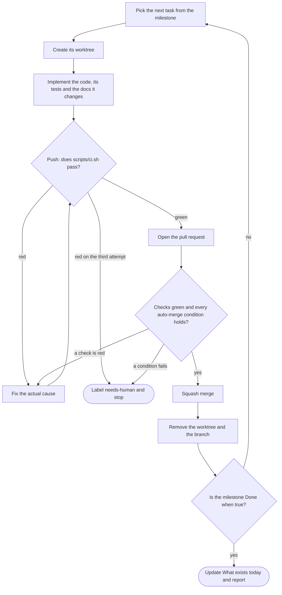

# The delivery loop

How work actually gets from a roadmap milestone into `main`. This is not advice — it is the loop,
and the generated `CLAUDE.md` and `NN-engineering-practices.md` both carry it so that a human and
an agent run the same one.

Two audiences, one process:

- **When writing the plan**, this file is the source for `NN-engineering-practices.md` §Pull
  requests and for the `CLAUDE.md` workflow section. Adapt the commands to the project; do not
  soften the gates.
- **When implementing the plan**, this file *is* the procedure. Run it per task, until the
  milestone is done.

---

## 1. The loop

One task in, one merged commit out. Repeat until the milestone's **Done when** is true.



| Step | Command |
|---|---|
| worktree | `wt switch --create <type>/<milestone>-<slug>` |
| gate | `git push`, whose pre-push hook runs `./scripts/ci.sh` |
| open | `gh pr create --base main --fill --label goal:<milestone>` |
| wait and merge | `gh pr merge --squash --auto` when the checks are hosted; `gh pr merge --squash` when they run locally only |
| clean up | `git fetch --prune origin && wt remove` |

The pre-push hook is `.husky/pre-push` on the web profile and lefthook's `pre-push` on macos. Both
run the same `./scripts/ci.sh`.

Nothing in this loop is optional and nothing in it is reordered. In particular: **the gate runs
before the pull request exists**, so a red branch never becomes somebody's review.

### 1.1 One task, one worktree

Every task gets its own worktree, created with [worktrunk](https://worktrunk.dev) (`wt`). The
primary checkout stays on `main` and clean, two tasks never share a working tree, and several
tasks can run at once, one agent per worktree, without stepping on each other.

What makes a worktree usable the moment it exists lives in `.config/wt.toml`, versioned with the
code (§9 of the profile's baseline file has it): the install, which also writes the git hooks,
so the gate exists in every worktree. On web, also the env files, copied from the primary worktree
through `.worktreeinclude`, and a dev-server port and a database name derived from the branch, so
two worktrees never collide. On macos, the generated Xcode project instead, since it is never
committed; build products stay inside the worktree, and the one thing two worktrees still share is
the development build's bundle identifier. Nothing is copied by hand. Project hooks are shell commands from the
repository, so `wt` runs them only once they are approved on the machine: `wt config approvals add`,
once per clone and again whenever a hook changes. Without that, a non-interactive `wt switch
--create` (an agent's) stops at the approval prompt and creates nothing.

Two commands are deliberately not in the loop:

- **`wt merge`.** It merges into `main` locally, which skips the pull request, the review and the
  hosted checks. Work leaves a worktree through a pull request and nothing else.
- **`gh pr merge --delete-branch`.** It tries to check out `main` and delete the local branch,
  and inside a linked worktree that fails because `main` is checked out in the primary one. It is
  also redundant: the repository deletes the remote branch on merge (`references/repository.md`
  §1), and `wt remove` deletes the worktree and the local branch once the fetch shows it as merged
  (squash merges included).

`wt remove` refuses a worktree with uncommitted changes and keeps a branch it cannot prove was
merged. Both refusals are information, not obstacles: never answer them with `--force` or `-D`
unless the pull request is merged and the leftover is understood.

## 2. Which repository

The remote is decided once, at intake, and written into `CLAUDE.md` under **Repository**:

```markdown
## Repository

`git@github.com:<owner>/<repo>.git` — `main` is protected and is the only merge target.
Every pull request is opened against it. There is no second remote and no fork.
```

What "protected" means — squash only, branch deleted on merge, auto-merge allowed, a ruleset
requiring every hosted check, no bypass — is in `references/repository.md`, applied by
`scripts/configure-repo.sh` as a task of `M0`.

If it is not known at planning time, the plan says `<to be determined>` in that one place and
nowhere else, and the first task of `M0` is to create it and fill it in. Never guess a remote, and
never open a pull request against a repository the user did not name.

## 3. Implement

A task is done when all three of these are true, not one:

1. **The code.** Inside the current declared goal, and nothing else — a drive-by refactor in an
   unrelated file is a separate pull request.
2. **The tests.** The layer the change belongs to, per the testing table. A behaviour described in
   `docs/` arrives with the test that would fail if it were dropped.
3. **The documents.** A change to behaviour described in `docs/` updates that document **in the
   same pull request**. Documentation drift is the failure mode of a plan this detailed.

Size budget: under about 400 changed lines, excluding lockfiles, generated migrations and
snapshots. If it does not fit, it is more than one pull request — stack them.

## 4. The gate: `scripts/ci.sh`

One file holds every check job. The pre-push hook runs it, so a push is the gate and the pull
request is proved before it is opened rather than after. The script below is the web profile's;
the macos one, with the same structure, is in `references/stack-macos.md` §9.

The file **skips rather than fails** for a job whose subject does not exist yet, so the same script
is correct from `M0` to the last milestone and the suite grows by things being built rather than by
anyone editing it.

```bash
#!/usr/bin/env bash
# Every check this project has. Run by .husky/pre-push, and by hand as `pnpm ci`.
# CI_FAST=1 omits the container-backed jobs.
set -uo pipefail

failed=()
run() { # run <name> <command...>
  local name="$1"; shift
  printf '\n\033[1m── %s\033[0m\n' "$name"
  if "$@"; then
    printf '\033[32m   ok\033[0m\n'
  else
    printf '\033[31m   FAILED\033[0m\n'
    failed+=("$name")
  fi
}
skip() { printf '\n\033[1m── %s\033[0m\n\033[33m   skipped — %s\033[0m\n' "$1" "$2"; }

run  "format and lint"  pnpm biome ci .
run  "typecheck"        pnpm turbo typecheck
run  "unit tests"       pnpm turbo test
run  "commit messages"  ./scripts/check-commits.sh

# Jobs whose subject may not exist yet: skip with the reason, never fail.
if [ -d packages/db/drizzle ]; then
  run "migrations are generated" ./scripts/check-migrations.sh
else
  skip "migrations are generated" "no schema package yet"
fi

if [ -n "${CI_FAST:-}" ]; then
  skip "integration tests" "CI_FAST=1"
  skip "end-to-end tests"  "CI_FAST=1"
elif ! docker info >/dev/null 2>&1; then
  skip "integration tests" "Docker is not running"
  skip "end-to-end tests"  "Docker is not running"
else
  run "integration tests" pnpm turbo test:integration
  if [ -d apps/web/e2e ]; then
    run "end-to-end tests" pnpm turbo test:e2e
  else
    skip "end-to-end tests" "no browser surface yet"
  fi
fi

if [ ${#failed[@]} -gt 0 ]; then
  printf '\n\033[31m%d job(s) failed: %s\033[0m\n' "${#failed[@]}" "${failed[*]}"
  exit 1
fi
printf '\n\033[32mall checks passed\033[0m\n'
```

Two properties worth keeping and worth writing down:

- **It runs every job before reporting.** A script that exits on the first failure makes you push
  four times to find four problems.
- **A skip prints its reason.** A silent skip is indistinguishable from a pass, which is the one
  thing a gate may never be.

`.husky/pre-push` is then one line:

```bash
./scripts/ci.sh
```

### When the checks are hosted instead

If `NN-engineering-practices.md` put the suite in GitHub Actions, `.github/workflows/ci.yml` has
one job per `scripts/ci.sh` job, calling the same package scripts (`references/repository.md` §4
has it per profile), the ruleset requires every one of them, and `pre-push` stays as the fast local
proof. The loop is unchanged; the merge step becomes `gh pr merge --squash --auto`, which waits for
the required checks itself.

**Say out loud which one is true**, and if it is the local hook, say what it costs: the checks are
enforced by the author's own machine, so `git push --no-verify` is a way past them and a green pull
request proves only that whoever pushed it did not use that flag.

## 5. Open the pull request

```bash
gh pr create --base main --label "goal:<milestone>" \
  --title "<type>(<scope>): <subject>" \
  --body "$(cat <<'BODY'
## What changed
<one paragraph>

## Why
Milestone <Mn>, <FR-xx>. <link to the document section this implements>

## How it was verified
<the tests added, and the command that proves it>

## Risk if this is wrong
<what breaks, and how it would be noticed>
BODY
)"
```

The title follows Conventional Commits, because squash merge makes the pull request title the
commit on `main`. Four sections in the body, always the same four — the fourth is the one people
skip and the one that catches things.

## 6. Wait, then merge

```bash
# hosted checks: GitHub merges once every required check is green
gh pr merge --squash --auto
gh pr checks --watch     # returns non-zero if any check fails; then fix and push, per §7

# local checks only: the gate already ran on push
gh pr merge --squash

# then, per §1.1. The remote branch was deleted by the merge.
git fetch --prune origin
wt remove                # the worktree, and the local branch now that main contains it
```

Enable auto-merge only after the conditions below were checked: it merges without asking again.

**Auto-merge is allowed only when every one of these holds:**

- the change is inside the current declared goal;
- every required check passes — when the suite is local, that is the `pre-push` gate green;
- there is no `needs-human` label;
- no file is touched under CI workflows, infrastructure or deployment config, migrations with
  destructive DDL, or anything holding secrets;
- *macos:* no change to signing, entitlements, the bundle identifier, the updater's checks, or a
  persisted file format without a decoder for the previous version;
- *cli:* no command, flag or `--json` field removed or renamed, and no exit code changed;
- no public type in the pure domain package changed (`packages/domain` on web, `<Name>Core` on
  macos, `src/core` on cli);
- no decision-recording document in `docs/` changed;
- the diff is within the size budget.

If any condition fails: apply `needs-human`, write why in a comment, and stop. **Do not work
around the condition.** A human merging it is the point.

## 7. When a check fails

Read the failing job. Fix the actual cause. Push again.

**Three attempts maximum**, then label `needs-human`, write down what was tried and what was
learned, and stop. Three failures on the same check is evidence the problem is not where you are
looking.

Never "fix" a check by:

- deleting a test, or skipping it, or marking it `.todo`;
- loosening a lint rule, or adding an ignore comment;
- widening a type, or adding `any`, or a non-null assertion;
- pushing with `--no-verify`;
- re-running the job hoping for a different result.

Each of those converts a caught problem into an uncaught one, which is strictly worse than the red
check.

## 8. Continue

Take the next task and run the loop again. The milestone is finished when its **Done when**
sentence is true — verified, not assumed — at which point:

- update the **What exists today** table in `CLAUDE.md` in the same pull request as the last task;
- report the milestone as done, with the evidence that its **Done when** holds;
- start the next milestone.

Stop the loop and come back to the user when: the milestone is done, a `needs-human` label was
applied, a decision in the register turns out to be wrong, or the work needs a `D-xx` that does not
exist. Those four, and nothing else — in particular, not "this task was hard".

## 9. Writing this into the generated plan

`NN-engineering-practices.md` gets §1 to §8 above, adapted, as its **Pull requests**, **The check
suite** and **Hooks** sections, and §1.1 as the worktree part of **Local development**. Its
repository section gets the settings and the ruleset from `references/repository.md`, each with
its reason.

`CLAUDE.md` gets the compressed version: the **Repository** block from §2, the loop diagram from
§1 with its command table, the two commands §1.1 keeps out of the loop, the auto-merge checklist from §6, and the
never-do list from §7 verbatim. It is the file an
agent reads at the start of every session, so the never-do list earns its space there more than
anywhere else.
