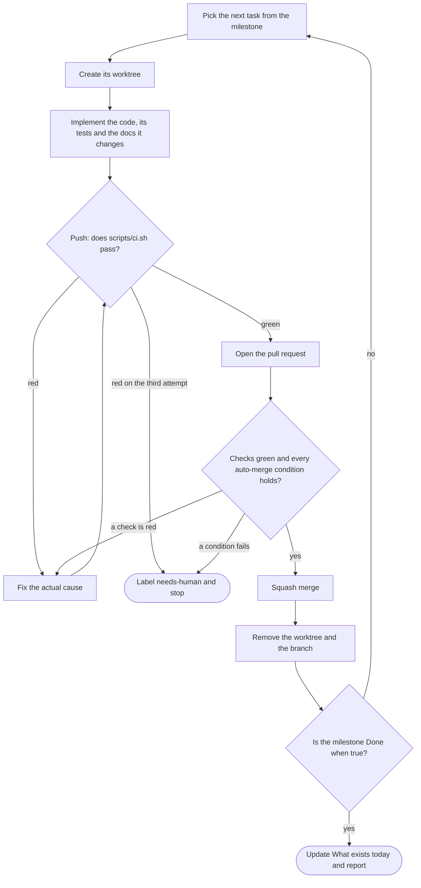

<!-- TEMPLATE. Spec: references/root-files.md. Keep under ~300 lines. Delete these comments. -->
# CLAUDE.md

This file provides guidance to Claude Code (claude.ai/code) when working with code in this
repository. It is written to be useful to any other agent too — nothing in it is specific to one
tool.

## What this project is

<Two sentences.> The plan is written down in detail and is the source of truth for behaviour:

| If you are about to… | Read |
|---|---|
| implement or change any behaviour | [`docs/01-product.md`](docs/01-product.md) |
| <task phrased as a task, not a topic> | [`docs/NN-….md`](docs/NN-….md) |

**A PR that changes behaviour described in `docs/` updates that document in the same PR.**
Documentation drift is the failure mode of a plan this detailed.

## What exists today

The plan describes the finished system. The repository is part-way there, and the rest of this file
describes the target rather than the tree, so check here before reaching for something.

| Built | Not built yet |
|---|---|
| <package — what of it> | <package> |

<!-- The only place carrying the difference between plan and tree. A PR that builds one updates it. -->

## Non-negotiables

1. **Everything is in English** — code, identifiers, comments, commit messages, PR bodies,
   documentation. <Product copy exception, if the users speak another language. Copy lives in data
   or a locale file, never inline in a handler.>
2. **Every change is a pull request.** `main` is protected. No direct pushes, not even from the
   maintainer, not even for a typo.
3. **`packages/domain` performs no I/O.** <!-- macos: `<Name>Core` and the rules target. cli: `src/core`. --> No `fetch`, no database client, no `fs`, no
   `process.env`, no clock. Time and randomness arrive as arguments. Enforced by lint, not by
   discipline.
4. **No mocking of our own modules.** Providers are replaced at the network edge.
5. <The project-specific ones: what is never stored, what is never logged, what a restricted read
   path may never return, what moves inside a transaction.>

## Commands

| Command | What it does |
|---|---|
| `pnpm dev` | <…> |

<!-- Include the commands the plan promises but that have nothing to run yet, and say so. -->

## Architecture in one screen

```mermaid
flowchart TD
    %% One screen, literally. references/diagrams.md has the rules.
```

## Package boundaries

<!-- macos: title this "Target boundaries". Enforced by SwiftPM's declared dependencies, plus
     apps/macos/scripts/check-imports.sh for what the compiler cannot see. Rows are the
     <Name>Kit targets; <Name>Core imports only Foundation.
     cli: title this "Layers". Rows are core, commands, adapters, render, enforced by Biome's
     rules on src/core/**. Add a "Command-line contract" section after it: stdout and stderr,
     --json, the exit codes (references/stack-cli.md §3). -->

Enforced by Biome's `noRestrictedImports`. A violation fails the `lint` job; it is not a review
comment.

| Package | May import | Must never import |
|---|---|---|
| `@<project>/domain` | nothing | every workspace package, every Node builtin, every I/O library |

Internal packages are consumed as TypeScript source (`"exports": { ".": "./src/index.ts" }`). Only
`apps/*` produce artifacts.

<!-- Note the sharp edges: exact-specifier matching, a subpath being a new hole. -->

## Conventions

<!-- Types, exports, file names, naming per layer, error shape, logging, dates, money. -->

## Testing

| Layer | Runs against | In `pnpm test`? |
|---|---|---|

<!-- Coverage threshold that fails a build. The properties that must always hold. -->

## Repository

`git@github.com:<owner>/<repo>.git` — `main` is protected and is the only merge target. Every pull
request is opened against it. There is no second remote and no fork.

<!-- If unknown at planning time: `<to be determined>` here and nowhere else, and filling it in is
the first task of M0. Never guess a remote. -->

## The delivery loop

One task in, one merged commit out. Repeat until the milestone's **Done when** is true.



| Step | Command |
|---|---|
| worktree | `wt switch --create <type>/<milestone>-<slug>` |
| gate | `git push`, whose pre-push hook runs `./scripts/ci.sh` |
| open | `gh pr create --base main --fill --label goal:<milestone>` |
| wait and merge | `gh pr merge --squash --auto` when the checks are hosted; `gh pr merge --squash` when they run locally only |
| clean up | `git fetch --prune origin && wt remove` (the merge already deleted the remote branch) |

The gate runs **before** the pull request exists, so a red branch never becomes somebody's review.

- **One task, one worktree.** The primary checkout stays on `main`. Never `wt merge` (it merges
  locally and skips the pull request), and never `gh pr merge --delete-branch` (it fails inside a
  linked worktree; the clean-up step does its job). Never answer a `wt remove` refusal with
  `--force` or `-D` unless the pull request is merged.

- **Branches:** `feat/m2-<slug>`, `fix/<slug>`. The milestone prefix ties the branch to the roadmap.
- **Commits and PR titles:** Conventional Commits, scope is the workspace package. Squash merge
  makes the PR title the commit on `main`.
- **Size:** under ~400 changed lines, excluding lockfiles, generated migrations and snapshots.
- **Body:** what changed · why (milestone and `FR-xx`) · how it was verified · the risk if it is
  wrong.

**Auto-merge only when every one of these holds:** the change is inside the current declared goal;
every required check passes; there is no `needs-human` label; no file is touched under CI
workflows, infrastructure or deployment config, migrations with destructive DDL, or anything
holding secrets; no public type in `packages/domain` changed; no decision-recording document in
`docs/` changed; the diff is within the size budget. If any condition fails: apply `needs-human`,
write why in a comment, and stop. Do not work around the condition.
<!-- macos: add signing, entitlements, bundle id and persisted formats; cli: add no command, flag,
     --json field or exit code removed or renamed. Name the pure package of the profile. -->

**When a check fails:** read the failing job, fix the actual cause, push. Three attempts maximum,
then label `needs-human`, write down what was tried, and stop. Never "fix" a check by deleting a
test, skipping a test, loosening a lint rule, adding an ignore comment, widening a type, adding
`any`, pushing with `--no-verify`, or re-running the job hoping for a different result.

**Come back to a human when**, and only when: the milestone is done, `needs-human` was applied, a
decision in the register turns out to be wrong, or the work needs a `D-xx` that does not exist.

When a milestone's **Done when** becomes true, update the "What exists today" table above in the
same pull request as the last task of that milestone.

## Local development

<!-- macos: `make bootstrap`, `pnpm install`, `make gen build`; then that the .xcodeproj is
     generated, that two worktrees' Debug builds must not run at once, and a "Checking UI" section
     on the `--snapshot <directory>` mode (references/root-files.md).
     cli: `pnpm install`, `pnpm build`, running the built tool with XDG_CONFIG_HOME pointed at a
     scratch directory, and `UPDATE_GOLDEN=1` for the end-to-end golden files. -->

```bash
corepack enable
pnpm install
pnpm dev
```

Every task runs in its own worktree: `wt switch --create <branch>`. The hooks in
`.config/wt.toml` install dependencies (and with them the git hooks), copy the env files listed in
`.worktreeinclude`, and give the worktree its own ports and database. Nothing is copied by hand.
`wt list` shows every worktree with its dev-server URL; `wt dev` starts this one's.

<!-- Then the surprising parts: why processes do not run in containers locally, what the dev script
writes and when it refuses to, which ports and database this worktree got and where they are
written, why the backing services are shared across worktrees, what cleanup requires. -->
