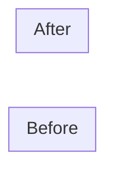

<!--
TEMPLATE. Delete every comment before delivering.
Spec: references/root-files.md. Voice: references/voice.md. Register: references/decisions.md.
Write this file first and completely. Everything else elaborates something stated here.
-->
# <Project><!-- add " — <subtitle>" only for a rewrite or a migration -->

> <One or two sentences. What it is, concretely enough that a stranger knows what the product does
> after reading only this. No adjectives that could apply to any product.>

<!-- One paragraph: what exists today, what this repository is, what state it is in. -->

**Status:** <planning (no code written yet) | in progress, milestone Mn | live>

---

## 1. The problem

<!--
The specific, checkable failure of whatever exists today. There is always a predecessor: a
competitor, a spreadsheet, a habit. Three to five bold-led paragraphs, one failure each, with
its mechanism and its cost. Or, for a product with a diffuse predecessor, a table of pains with
their symptoms followed by one sentence naming the systemic consequence.

"It does not scale" is not a problem statement. "The core operation is <the actual query>, which
in <the current platform> is <the actual cost>, on every single <unit>" is.
-->

**<Failure one, named>.** <Mechanism. Cost. What it works at and what it does not.>

**<Failure two, named>.** <…>

---

## 2. The proposal

<!-- What replaces it. A before/after diagram earns its place here more than anywhere else. -->

Concretely:

- **<Change one.>** <What it buys, in one or two sentences.>
- **<Change two.>** <…>

### What does not change

<!-- Rewrites only. This is what makes it a migration rather than a redesign. Delete otherwise. -->

---

## 3. Design principles

Tie-breakers, in order. When two options are defensible, the one higher on this list wins.

<!--
Five to eight. Each must be able to settle a real review comment. Test each one by asking: what
argument does this end? If the answer is "none", it is a value, not a principle. Delete it.
-->

1. **<Principle.>** <The consequence, stated so it can be applied.>
2. **<Principle.>** <…>

---

## 4. Scope

### v1.0 — <what this release is for, in three words>

<!-- Everything in it, as a bullet list specific enough to check off. -->

### v1.1 / v1.2

<!-- Ordered, not dated. -->

### Out of scope

<!-- With the reason for each exclusion, and its reversal condition where it has one. -->

---

## 5. Document map

| Document | What it settles |
|---|---|
| [`docs/01-product.md`](docs/01-product.md) | <…> |

<!-- Must match the directory exactly. Checked in the consistency pass. -->

[`CLAUDE.md`](CLAUDE.md) is the working agreement for anyone — human or agent — writing code here.

---

## 6. Decisions

Open decisions carry a recommendation. Closed decisions keep their ID and gain the reasoning, so a
question is never re-litigated by accident.

| ID | Decision | Resolution | Impact |
|---|---|---|---|
| **D-01** | <question, five to nine words; strike through when closed> | **Closed — <answer>.** <Argument. The strongest alternative, named, and the specific property of this project that decided against it. **Revisit if** <observable event>.> | High |

---

## 7. <Project-specific>

<!--
Include only with something real in it: a state legend, the naming table that follows from the
product name, "how to use this plan" with the suggested refinement order.
-->
