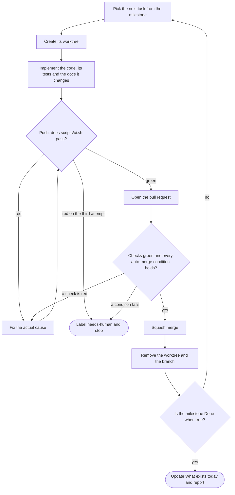

<!-- TEMPLATE. Spec: references/document-specs.md. Source for §3–§5: references/workflow.md. -->
# NN — How we work

## 1. Principles

<!-- Three to five. Each must decide something. "The gate runs before the pull request exists."
     "A skipped job prints its reason, because a silent skip is indistinguishable from a pass." -->

## 2. Toolchain

| Tool | Role |
|---|---|

<!-- web: pnpm via corepack, Turborepo, Biome (no ESLint, no Prettier — say that adding them back
     is out of bounds), Husky, lint-staged, commitlint, Vitest, Testcontainers, Playwright.
     macos: Xcode, XcodeGen, SwiftPM, swift-format, SwiftLint, Swift Testing, lefthook,
     commitlint, gitleaks, the Brewfile, release-please (references/stack-macos.md §2). -->

## 3. The repository, branches and commits

Pull requests are opened against `<remote>`. `main` is protected and is the only merge target.

<!-- The settings and the ruleset from references/repository.md §1 and §2, as a table of setting ·
     value · why: squash only with the PR title and body as the commit, auto-merge allowed, branch
     deleted on merge, Dependabot security updates, the ruleset (no deletion, no force push, linear
     history, a pull request with N approvals, conversations resolved, every hosted check required,
     no bypass). Say that `scripts/configure-repo.sh` applies them and is re-run when a required
     check is added. On a private repository without a paid plan, say the ruleset is not enforced
     and what that leaves. -->

- **Branches:** `feat/m2-<slug>`, `fix/<slug>`. The milestone prefix ties the branch to
  [`NN-roadmap.md`](NN-roadmap.md).
- **Commits:** Conventional Commits, scope is the workspace package name. Allowed types: `feat`,
  `fix`, `refactor`, `perf`, `test`, `docs`, `build`, `ci`, `chore`, `revert`.
- **PR titles** follow the same convention — squash merge makes the title the commit on `main`.

## 4. The delivery loop

One task in, one merged commit out. Repeat until the milestone's **Done when** is true.



| Step | Command |
|---|---|
| worktree | `wt switch --create <type>/<milestone>-<slug>` |
| gate | `git push`, whose pre-push hook runs `./scripts/ci.sh` |
| open | `gh pr create --base main --fill --label goal:<milestone>` |
| wait and merge | `gh pr merge --squash --auto` when the checks are hosted; `gh pr merge --squash` when they run locally only |
| clean up | `git fetch --prune origin && wt remove` (the merge already deleted the remote branch) |

A task is done when three things are true, not one: the code, the tests for the layer it belongs
to, and **the documents it changes, in the same pull request**. Documentation drift is the failure
mode of a plan this detailed.

Size budget: under ~400 changed lines, excluding lockfiles, generated migrations and snapshots. If
it does not fit, it is more than one pull request.

The body states four things, always the same four:

```
## What changed
## Why            — milestone, FR-xx, the document section this implements
## How it was verified
## Risk if this is wrong
```

### 4.1 Auto-merge conditions

<!-- The checklist. Every item must hold. Then: if any fails, apply needs-human, write why, stop —
     do not work around the condition. -->

### 4.2 When a check fails

Read the failing job, fix the actual cause, push. **Three attempts maximum**, then label
`needs-human`, write down what was tried, and stop.

Never "fix" a check by deleting a test, skipping a test, loosening a lint rule, adding an ignore
comment, widening a type, adding `any`, pushing with `--no-verify`, or re-running the job hoping
for a different result. Each of those converts a caught problem into an uncaught one.

### 4.3 When to stop

The milestone is done · `needs-human` was applied · a decision in the register turns out to be
wrong · the work needs a `D-xx` that does not exist. Those four.

## 5. The check suite

<!-- Where it runs, and what that costs. If it is the local hook, say plainly that `--no-verify`
     is the way past the only gate there is, and name the condition that would move it to a
     hosted workflow. -->

| Job | What it runs | Skips when |
|---|---|---|
| format and lint | `biome ci .` | never |
| typecheck | `turbo typecheck` | never |
| unit tests | `turbo test` | never |
| integration | `turbo test:integration` | Docker is not running, or `CI_FAST=1` |
| end to end | `turbo test:e2e` (Playwright) | no browser surface yet, Docker is not running, or `CI_FAST=1` |
| migrations | regenerate and assert nothing new appears | there is no schema package yet |

<!-- macos rows instead: commit messages · secrets (gitleaks) · format and lint (`make lint`) ·
     imports (`check-imports.sh`) · build and test (`make ci`), the last three skipping while
     there is no `apps/macos/project.yml`. -->
<!-- cli rows instead: format and lint · typecheck · unit · integration (commands in-process
     against a temporary home and a stub server) · end to end (pack, install, run the installed
     binary). See references/stack-cli.md §5. -->

<!-- When the checks are hosted: the jobs of .github/workflows/ci.yml, one per row above, and that
     the ruleset requires each by name (references/repository.md §4). -->

A job whose subject does not exist yet **skips with its reason printed** — never fails, and never
passes silently. That is what lets the same `scripts/ci.sh` be correct from `M0` to the last
milestone.

## 6. Hooks

| Hook | Runs |
|---|---|
| `pre-commit` | `lint-staged` — Biome over staged files. *macos:* lefthook runs swift-format, SwiftLint, Biome and gitleaks over staged files |
| `commit-msg` | `commitlint` |
| `pre-push` | `./scripts/ci.sh` |

## 7. Local development

### 7.1 Worktrees

<!-- From references/workflow.md §1.1. One task, one worktree, created with `wt switch --create`.
     Then the `.config/wt.toml` hooks as a table — hook, what it runs, why — and what each
     worktree gets of its own (macos: the generated project and its build directory, and the
     shared Debug bundle identifier as the sharp edge): the dev-server ports (hash_port of repo and branch), the database
     (sanitize_db of the branch, on the shared dev Postgres), and where both are written. Why the
     backing services are shared rather than per worktree. The two commands kept out of the loop,
     `wt merge` and `gh pr merge --delete-branch`, each with its reason. What `wt remove` refuses,
     and that the database of a removed worktree is dropped by hand. -->

## 8. Environments

## 9. Secrets

<!-- `.env.example` documents every variable with a fake value; `.env` is ignored and never printed
     to a log. Rotation lives in NN-provider-setup.md. -->

## 10. Definition of done

- <checkable>
